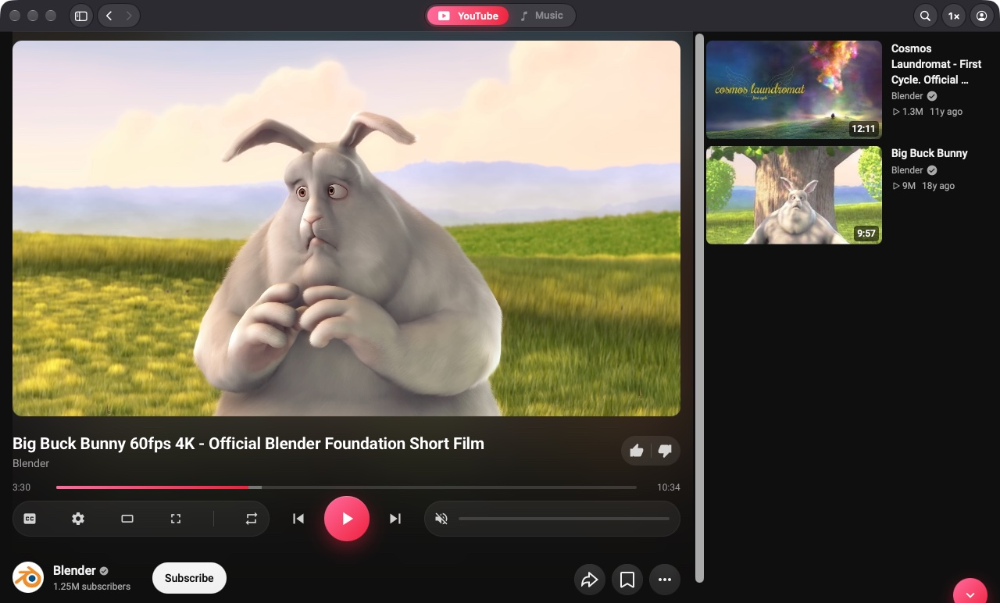
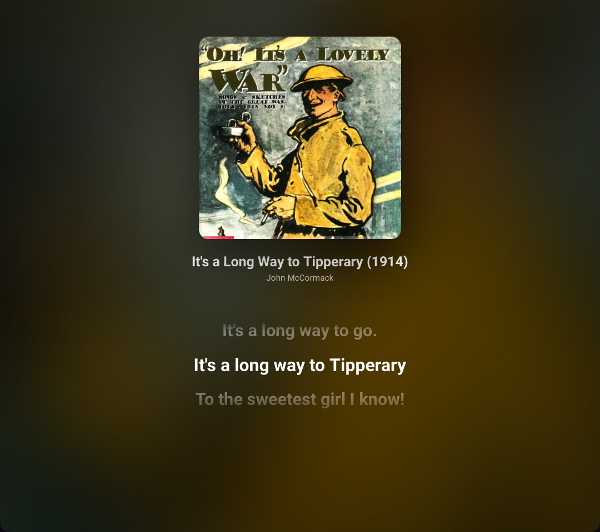

# ViewTube

English · [Português](README.pt-BR.md)

YouTube and YouTube Music in one light, native macOS app.



## Highlights

- **Switch modes and keep the track.** One click on the YouTube | Music switch (or ⇧⌘M) moves what is playing to the other mode at the same point, playing or paused, full player or collapsed.
- **One player for both sites.** The same control card under the video or the artwork: options on the left (Music | Video, theater, fullscreen, shuffle, repeat), transport in the middle, volume on the right. Volume, loudness normalization and video quality are shared by both modes.
- **YouTube Music the way it should be.**
  - A home built around your taste: most played, hits from your artists and suggestions, with discreet category chips.
  - Synced lyrics: YouTube Music's own lyrics first, [LRCLIB](https://lrclib.net) as a fallback. The current line stays highlighted, and a small sync control adjusts the timing per song.
  - Cover mode: a square artwork in place of the video.
  - Portrait fullscreen: the cover, the lyrics and a blurred moving background.
- **A tidy watch page.** Recommendations stay fixed on the right. Description, comments and related videos sit in tabs under the player, and the description is always expanded.
- **Narrow and portrait windows.** Both modes switch to a stacked layout below 1024 px: player on top, a compact "Up next" carousel, then tabs.
- **A collapsed bar shared by both modes.** Leaving a video collapses it to a bar at the bottom; clicking anywhere on the bar opens it again. Clicking a video or song anywhere always opens the full player.
- **A minimal native header.** On the left, ☰ plus back and forward; in the middle, the mode switch; on the right, search (which covers the whole bar), playback speed and your account.
- **Your Google account, natively.**
  - Sign in from the app or copy the session of your default Chromium browser.
  - Switch between accounts, including brand accounts.
  - Language, location, restricted mode and sign out in Settings.
- **App ⇄ browser.**
  - ⇧⌘O opens the current video in your default browser at the current time.
  - A bookmarklet (Settings → Browser) sends a video from Safari, Chrome, Arc or Firefox to the app.
  - With a YouTube link copied, ⇧⌘V or the search field opens it in the app.
- **Menu bar player.** The status item shows the artwork and the title. Its mini player has seek, shuffle, previous/next, repeat, like/dislike, volume and open in browser.
- **Media keys and Now Playing.** Control Center, keyboard media keys and headphones work.
- **Ad blocking and [SponsorBlock](https://sponsor.ajay.app).** Ad fields are pruned from the player response, with skipping as a fallback, and promotions are hidden.
- **No page reloads.** Each mode stays alive in its own page, so switching only swaps the view and carries the track over.



Native shell in Swift (AppKit + SwiftUI). Content comes from the system WebKit, with no bundled Chromium, so your Google sign-in, playlists and recommendations work as usual.

Requires macOS 14 or later. Liquid Glass on macOS 26 and later.

## Install

Pick one:

1. **Terminal, one line (recommended).** Paste this into Terminal:
   ```sh
   curl -fsSL https://witchmymac.com/install.sh | bash -s viewtube
   ```
   It downloads the latest release from GitHub, checks its SHA-256, installs ViewTube in Applications and opens it. There's no macOS warning, because files downloaded by `curl` don't get the "downloaded from the internet" mark. Run the same line again to update. The script is open: [install.sh](https://witchmymac.com/install.sh).
2. **Download the DMG** from [Releases](https://github.com/matthfaria96/viewtube-mac/releases) or [witchmymac.com](https://witchmymac.com), drag ViewTube to Applications, then allow it once with:
   ```sh
   xattr -dr com.apple.quarantine "/Applications/ViewTube.app"
   ```
   It only removes the "downloaded from the internet" mark from that app.
3. **Download the DMG** and allow it in System Settings: open the app, click OK on the warning, then go to System Settings → Privacy & Security and click Open Anyway.

## Keyboard shortcuts

| Shortcut | Action |
|---|---|
| ⌘1 / ⌘2 | YouTube / YouTube Music |
| ⇧⌘M | Switch mode, keeping the track |
| ⌘L | Search or paste a link |
| ⇧⌘V | Open the copied link |
| ⇧⌘O | Open in the browser |
| ⇧⌘C | Copy the link |
| ⌥⌘P | Play / pause |
| ⌃⌘S | Side menu |

## Control by URL

Useful for Shortcuts, Raycast or scripts:

| URL | Action |
|---|---|
| `viewtube://open?url=<encoded link>&t=<seconds>` | Opens a YouTube or Music link (this is what the bookmarklet uses) |
| `viewtube://watch?v=<id>&t=1m30s&mode=music` | Opens a video by id |
| `viewtube://play`, `pause`, `toggle`, `next`, `previous` | Playback |
| `viewtube://mode/youtube`, `mode/music`, `mode/toggle` | Switches mode and keeps the track |
| `viewtube://browser` | Opens the current video in the browser |
| `viewtube://speed/1.5` | Playback speed (0.25–3) |

## Build

```sh
scripts/build-app.sh            # tests + build/ViewTube.app
scripts/build-app.sh --install  # also copies it to /Applications and registers viewtube://
```

It needs Xcode installed. The script sets `DEVELOPER_DIR`, because the SwiftUI macros and XCTest don't ship with the Command Line Tools alone.

## License

GPL-3.0. Not affiliated with Google or YouTube. Inspired by [Pear Desktop](https://github.com/pear-devs/pear-desktop) and [Mooziac](https://github.com/shirkeharsh/mooziac), both MIT; no code from either project is included.

[witchmymac.com](https://witchmymac.com)
